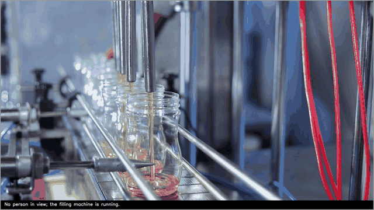
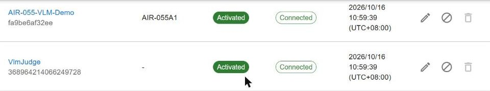

# VLM PPE Judge on Qualcomm Hexagon (AIR-055)

> A camera, a vision-language model on the Hexagon NPU, and a live verdict: does each person wear a hard hat and a high-visibility vest? Deploy it from the WEDA portal, watch it in a browser, and read the results in WEDA Cloud.

**Version:** 0.13.3
**Copyright:** © 2026 Advantech Corporation. All rights reserved.

**Contents**

- [Overview](#overview)
- [Quick start](#quick-start)
- [What you see](#what-you-see)
- [How the parts fit together](#how-the-parts-fit-together)
- [WEDA integration](#weda-integration)
- [Requirements and board checklist](#requirements-and-board-checklist)
- [Documentation](#documentation)

## Overview

A ready-to-demo application for the AIR-055. A camera looks at a scene; a vision-language model decides whether the people in it wear a hard hat and a vest; the result appears on a live web page, in the judge's log and in WEDA Cloud.

| At a glance | |
|---|---|
| **Checks** | Hard hat and vest for each person in the picture. Gloves and safety goggles can be added in the settings |
| **Model** | Gemma 4 E2B on the Qualcomm Hexagon NPU, built into the image: nothing to download |
| **Shows** | A live picture with the model's description and a state-coloured border, and one log line per judgement |
| **Reports to** | WEDA Cloud: 17 data streams, the judge state, and the command `judge.now` |
| **Deploys** | One stack file from the WEDA portal; no other file on the board |
| **Speed** | About 2 s per judgement, 4.5 s from the camera to the cloud |

How the data flows:

1. The camera gives the judge (`vlm-judge`) a picture every few seconds.
2. The judge asks the model server (`geniex-serve`, Gemma 4 E2B on the Hexagon NPU) about the picture, checks the answer and decides the verdict.
3. The judge shows the picture with the description on the live view (port 8080) and writes each judgement to its log.
4. The judge publishes the result as MQTT messages on the board's loopback broker.
5. The Sub-Node (`vlm-judge-subnode`) reads the messages and reports them through the WedaNode to WEDA Cloud.

The demo is best-effort and is **not a safety system**: the model is small and can be wrong.

## Quick start

1. **Deploy** the stack from the WEDA portal (Container Stacks, deploy icon, tick the board): [steps](docs/sop-run-on-edge-device.md#31-with-the-weda-portal). You only upload one file, `docker/weda-stack-vlm-demo.yml`, from your own computer; nothing is cloned or copied to the board and no variable is required.
2. **Open the live view.** Through WEDA, without the board's address and without touching the board: send one call to WEDA from your computer to open a tunnel to the board's port 8080, then open the address it returns ([steps](docs/sop-run-on-edge-device.md#34-open-the-live-view-through-a-weda-tunnel)). Or, on a trusted network, add the stack variable `HTTP_BIND` = `0.0.0.0` and open `http://<board address>:8080/` (the page has no login).
3. **Compare with the cloud:** in the WEDA portal open Devices, `VlmJudge`, Telemetry. The same verdict appears there within about 10 s.

**Without WEDA** (to try the judge on a board with Docker only): download or clone this repository onto the board, and run the following in its `docker` folder. Docker Compose 2.20 or newer is needed; settings can go into a `.env` file in the same folder.

```bash
cd docker && export COMPOSE_FILE=weda-stack-vlm-demo.yml
docker login <registry named in the stack file>                  # type the password yourself
docker compose pull
export DEVICE_ID=<board id> HTTP_BIND=0.0.0.0
docker compose up -d                                              # all four services, the live view at http://<board address>:8080/
docker compose logs --tail 5 vlm-judge                            # one line per judgement
```

Stop with `docker compose down`. If the board's WedaNode uses another password than the default, set `SystemConfig__WedaNode__Password` before `docker compose up`.

## What you see



**On the picture:** the model's one-sentence description at the bottom, and a border that shows the state: red for a violation, green for compliant, grey for nobody in view, amber when the result is older than 15 s.

**In the log** (`docker logs edge_vlm-ppe-demo_vlm-judge`): one line per judgement with its number, the state, the number of people, the time it took and the description, and a "demo only" notice when the judge starts (the third line below is an example of a violation):

```
INFO vlm_judge.runner: VLM scene understanding, demo only: not a PPE safety system
INFO vlm_judge.engine: judgement #2 NO_PERSON, people 0, 1.2 s: Jars are filled one after another, nobody is standing at the line.
INFO vlm_judge.engine: judgement #3 VIOLATION, people 2, 4.1 s: Two workers at the line, one without a hard hat.
```

Three settings in the stack switch these parts on or off:

- `VIEW_DESCRIPTION`: the sentence on the picture (on by default).
- `VIEW_HUD`: the state, number of people, judgement number and "demo only" label on the picture (off by default).
- `LOG_JUDGEMENTS`: the log lines (on by default).

The [reference](docs/vlm-container-reference.md#5-settings) lists all settings.

## How the parts fit together

In WEDA the demo appears as **two devices**; each has its own job.

| Name | What it is | Where you see it |
|---|---|---|
| **WEDA** | Advantech's cloud for managing edge devices: it deploys containers to boards and stores and shows their data | the WEDA web portal |
| **The board** (edge node) | the AIR-055, registered in WEDA as a device, here `AIR-055-VLM-Demo` (`fa9be6af32ee`). It runs the **WedaNode** agent (containers `dmagent`, `system-agent`), its link to WEDA | Devices list; **Container Stacks are deployed to this device** |
| **The Sub-Node** | the container `vlm-judge-subnode` (see [WEDA integration](#weda-integration)). WEDA shows it as its **own device**, here `VlmJudge` (`368964214066249728`) | Devices list; **its Telemetry tab holds the judge's data** |
| **The judge** | the AI application (container `vlm-judge`): camera, model, verdict. WEDA does not know it; it talks to the Sub-Node over a local MQTT broker | the web page on the board, port 8080 |



## WEDA integration

Two WEDA features carry the demo from the board to the cloud and back.

**The Sub-Node** is the container `vlm-judge-subnode`, built with the WEDA Sub-Node SDK. It reads the judge's local MQTT messages and registers the judge in WEDA as its own device, `VlmJudge`, through the board's WedaNode.

- It reports 17 data streams: the verdict, the counts, the description, the latency, the camera state and the counters.
- It keeps `judge_state` for the cloud: `CURRENT` while results arrive, `STALE` after 15 seconds without one, `OFFLINE` when the judge is gone, each with a reason.
- It takes one command from the cloud, `judge.now`, which returns a fresh verdict.
- It records locally, so a gap after a network outage can be filled in again.

The Sub-Node source is the example `examples/vlm-judge-subnode` of the WEDA Sub-Node SDK repository; the stack pulls its image. The reference describes the streams and the command ([data streams](docs/vlm-container-reference.md#3-data-streams-reported-to-weda-17), [`judge.now`](docs/vlm-container-reference.md#2a-the-weda-command-judgenow)) and the build guide the image.

**Tunnel management** is a WEDA feature that opens a secure connection from the cloud to a service on the board. Here it opens the live view through WEDA. It is an API call, not a screen: the [steps](docs/sop-run-on-edge-device.md#34-open-the-live-view-through-a-weda-tunnel) are in the deployment guide.

## Requirements and board checklist

- **Board:** AIR-055 with the Qualcomm® Dragonwing™ IQ-9075 (Hexagon NPU, two compute cores)
- **OS:** Ubuntu 24.04 (arm64), Docker with Compose 2.20 or newer
- **Camera:** a USB UVC camera on `/dev/video0`, or a video file instead
- **Free space:** 8 GB of memory and 20 GB of disk before the first deploy
- **Time:** the board's clock synchronised (NTP), because results carry the board's timestamps

If the demo does not start, work through the [board checklist](docs/sop-run-on-edge-device.md#board-checklist).

## Documentation

| Document | Content |
|---|---|
| [Deployment and Operations Guide](docs/sop-run-on-edge-device.md) | Deploy (WEDA portal, WEDA API, Docker Compose), verify, operate, open the live view through a tunnel, troubleshoot |
| [Reference](docs/vlm-container-reference.md) | How it works, MQTT messages, data streams, settings, limits, security, performance, WEDA integration |
| [Optional HTTP API](docs/api.md) | The API that is off by default: calls, a client example, rules for trusting a result |
| [Build and Release Guide](docs/sop-build-push-image.md) | For maintainers: build the images, scan, push, and the files of the repository |
