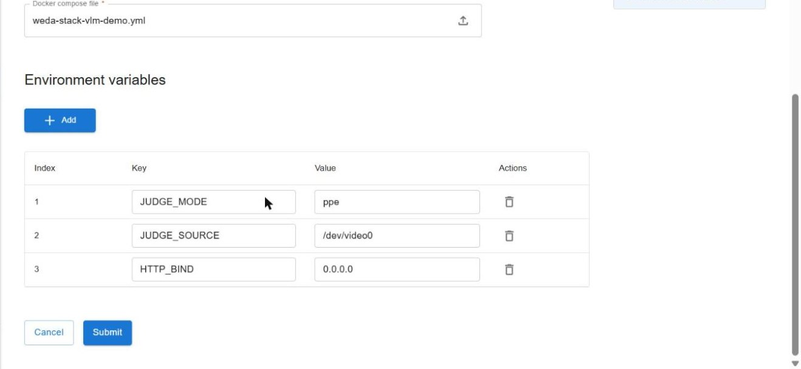
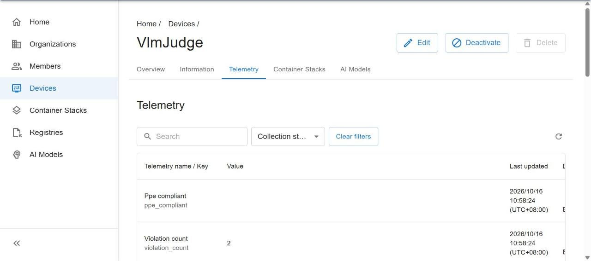

# Deployment and Operations Guide

**Contents**

- [1. Overview](#1-overview)
- [2. Prerequisites](#2-prerequisites)
- [3. Deploy](#3-deploy)
- [4. Verify](#4-verify)
- [5. Operate](#5-operate)
- [6. Troubleshooting](#6-troubleshooting)

## 1. Overview

The demo is one WEDA stack of four services on the AIR-055, all on the host network. The image versions are named in `docker/weda-stack-vlm-demo.yml`.

| Service | Image | Role |
|---|---|---|
| `geniex-serve` | `qualcomm/geniex:v0.7.1` | Model server on `127.0.0.1:18181`, with a supervisor that restarts it when it stops answering |
| `vlm-judge` | `vlm-judge` | Camera, judge, live view (port 8080), and an optional API (off by default). The model is built into the image |
| `mqtt-broker` | `eclipse-mosquitto:2.1.2-alpine` | Local message broker, listening on `127.0.0.1` only |
| `vlm-judge-subnode` | `vlm-judge-subnode` | Reports the judge's results to WEDA Cloud through the WedaNode |

## 2. Prerequisites

- **Board:** meets the checklist in the [README](../README.md#requirements-and-board-checklist).
- **WedaNode:** installed, and the board is registered: `dmagent`, `system-agent` and `watchtower` run, and the device shows Activated and Connected.
- **Registry:** your organisation has a registry entry, with a credential, for the registry named in the stack file (`GET /api/v1/orgs/{orgId}/containers/registries`). Your WEDA administrator provides the credential. The agent uses it to pull every image of a revision.
- **Values at hand:** the board's 12-character id (portal: Devices, the board's row), its address on your network (`hostname -I` on the board), and a WEDA portal login (SIT environment: [weda-sit-k3s.weda.dev/central/weda](https://weda-sit-k3s.weda.dev/central/weda), organisation `central`).

No other preparation is needed on the board:

- The model is built into the judge image. Docker fills the empty volume `vlm-geniex-data` from it when the judge container is first created (about two minutes); `geniex-serve` waits until the model is there.
- The WedaNode login is built into the Sub-Node image. Only if the board's WedaNode uses a different password, set the stack variable `SystemConfig__WedaNode__Password`.
- Docker creates the registration folder `/opt/Advantech/vlm-judge-subnode/weda-data-sit`. It keeps the Sub-Node the same WEDA device across redeploys: do not delete it.

## 3. Deploy

### 3.1 With the WEDA portal

Follow the [WEDA guide: Deploy Container to Device](https://learn.advantech.com/weda/docs/Getting_Started/Deploy_Container_to_Device/). For this demo:

| Step | What to do |
|---|---|
| Registry | The registry of the images is listed under Registries, with a credential |
| Compose file | Upload `docker/weda-stack-vlm-demo.yml` |
| Environment | Nothing is required: all settings have defaults. To open the live view straight from your network, add `HTTP_BIND` = `0.0.0.0` (no login: trusted networks only), or use a tunnel (3.4) |
| Device | Deploy to the board only |
| Check | After about a minute the board shows `Running` under the newest version |



To judge the built-in demo clip instead of the camera, add `JUDGE_SOURCE` = `/app/clips/OD_Jar.mp4`. The settings are listed at the top of the stack file and in the [reference](vlm-container-reference.md#5-settings).

Saving a stack creates a new version and deploys nothing. A deploy recreates the services whose configuration changed; usually that is only the judge. If the model server restarts as well, the first result takes about a minute while the model loads. A rollback recreates all four; the Sub-Node stays the same WEDA device.

### 3.2 With the WEDA API

You need a token (valid 2 hours, from your WEDA login; an expired one answers `401 token is expired`), your organisation id (portal: Organizations) and the board's id (portal: Devices, the board's row). Tools: `curl`, `jq` and `openssl`. The SIT server's certificate is self-signed: save it and let `curl` check against it.

```bash
openssl s_client -connect weda-sit-k3s.weda.dev:443 -servername weda-sit-k3s.weda.dev -showcerts </dev/null 2>/dev/null \
  | awk '/BEGIN CERT/,/END CERT/' > weda-sit-k3s.pem
export B=https://weda-sit-k3s.weda.dev/central/weda ORG=<organisation id> DEV=<board id> TOK=<token> CA=$PWD/weda-sit-k3s.pem
```

**Create the stack** (once). Note `stackConfigId` in the answer:

```bash
jq -n --rawfile c <(base64 -w0 docker/weda-stack-vlm-demo.yml) --arg dev "$DEV" \
  '{stackName:"vlm-ppe-demo",type:"compose",composeFileContent:$c,environment:{DEVICE_ID:$dev}}' \
  | curl -s --cacert $CA -X POST -H "Authorization: Bearer $TOK" -H "Content-Type: application/json" -d @- $B/api/v1/orgs/$ORG/stack-configs | jq
```

**Create a new revision** (after a change to the stack file or a setting; send the full `environment` each time):

```bash
export SC=<stackConfigId>
REV=$(jq -n --rawfile c <(base64 -w0 docker/weda-stack-vlm-demo.yml) --arg dev "$DEV" \
  '{description:"what changed",composeFileContent:$c,environment:{DEVICE_ID:$dev}}' \
  | curl -s --cacert $CA -X PATCH -H "Authorization: Bearer $TOK" -H "Content-Type: application/json" -d @- $B/api/v1/orgs/$ORG/stack-configs/$SC | jq -r .stackRevisionId)
```

**Deploy the revision:**

```bash
curl -s --cacert $CA -X POST -H "Authorization: Bearer $TOK" -H "Content-Type: application/json" -d "{\"deviceIds\":[\"$DEV\"]}" \
  $B/api/v1/orgs/$ORG/stack-configs/$SC/revisions/$REV:deploy -o /dev/null -w "%{http_code}\n"
```

**Watch it** until all four containers are `running` (about 2 minutes; the first deploy pulls about 4.5 GB, so a slow link takes longer; do not deploy again while it shows `deploying`):

```bash
curl -s --cacert $CA -H "Authorization: Bearer $TOK" "$B/api/v1/orgs/$ORG/stack-configs/deployments?stackNames=vlm-ppe-demo" \
  | jq -c '.items[0]|{status,reason,containers:[.containers[]|{name,state}]}'
```

Do not set `container_name` in the stack: WEDA names the containers `edge_<stack>_<service>`.

### 3.3 With Docker Compose (no WEDA)

For debugging on a board with Docker only. The commands are in the [README](../README.md#quick-start), under "Without WEDA". The stack file is also a Docker Compose file, so the settings of the [reference](vlm-container-reference.md#5-settings) apply.

### 3.4 Open the live view through a WEDA tunnel

WEDA tunnel management opens a secure connection from the cloud to a service on the board. For this demo it gives access to the live view without the board's IP address and without touching the board. You send a call from your own computer, and WEDA tells the board's agent to open the connection from its side. The connection is outbound, so the board needs no open port. Tunnel management is an API, as the WEDA documentation describes ([Tunnel Management](https://learn.advantech.com/weda/docs/Function_Explaination/Tunnel_Management), [Create tunnel session](https://learn.advantech.com/weda/api/create-tunnel-session), [Remote Access Tunnel tutorial](https://learn.advantech.com/weda/docs/Tutorials/Remote-Access-Tunnel/)). The portal has no tunnel screen.

**You need:** a WEDA access token (valid 2 hours, from your WEDA login), the board's id (portal: Devices, the board's row), the board online and Activated, and a computer that can reach WEDA and the tunnel address (company network or VPN). The variables `$B`, `$DEV`, `$TOK` and `$CA` are those of 3.2.

**1. Send the call that opens the tunnel.** It answers `202`; note `tunnelSessionId`:

```bash
curl -s --cacert $CA -X POST -H "Authorization: Bearer $TOK" -H "Content-Type: application/json" \
  -d '{"serviceType":"http","applicationHost":"127.0.0.1","applicationPort":8080,"purpose":"VLM judge live view","tags":["vlm-demo"]}' \
  $B/api/v1/devices/$DEV/tunnels/sessions | jq
```

**2. Ask for its state until it is established** (usually a few seconds). Then open `http://<tunnelEndpoint>/` in a browser: that is the live view.

```bash
curl -s --cacert $CA -H "Authorization: Bearer $TOK" $B/api/v1/devices/$DEV/tunnels/sessions/<tunnelSessionId> | jq '{sessionStatus,healthStatus,tunnelEndpoint}'
```

`sessionStatus` is `ESTABLISHED` (or `1`) when ready, and `tunnelEndpoint` is a bare `host:port` without a scheme.

**3. Close it when you are done.** It answers `202`; the request needs the body:

```bash
curl -s --cacert $CA -X DELETE -H "Authorization: Bearer $TOK" -H "Content-Type: application/json" \
  -d '{"reason":"demo finished","graceful":true,"forceTimeout":30}' $B/api/v1/devices/$DEV/tunnels/sessions/<tunnelSessionId>
```

**Notes**
- `tags` needs at least one entry. The address is an access key to the board: do not share it.
- A tunnel closes by itself after 120 seconds without a client and after 3600 seconds at most. Open a new one then.
- One port per tunnel: the live view (8080) and the optional API (8081) need separate tunnels.
- A `401` means the token expired: sign in again.
- If the tunnel does not become healthy, the board's agent could not reach the port on `127.0.0.1`. Use the board's own network address (`hostname -I`) as `applicationHost` and set the stack variable `HTTP_BIND` to `0.0.0.0`. On this board `127.0.0.1` works.
- `GET $B/api/v1/devices/$DEV/tunnels/sessions` lists the sessions of the board, so you can check that none was left open.

## 4. Verify

Check in this order; each step proves something the previous one does not.

**1. The containers run.** The deployment status shows `running` and four containers (portal, or the watch command in 3.2). On the board, `docker ps` lists `edge_vlm-ppe-demo_*` for all four services.

**2. The judge publishes.** On the board:

```bash
docker exec edge_vlm-ppe-demo_mqtt-broker mosquitto_sub -h 127.0.0.1 -t 'advantech/+/vision-vlm/#' -v -C 4 -W 12
```

You should see `status online`, then `meta`, `health` (`"camera":"OK"`) and `judgements` every few seconds. `stats` follows once a minute, so it is not among the first four.

**3. The judge works.** `docker logs --tail 3 edge_vlm-ppe-demo_vlm-judge` shows one line per judgement, such as `judgement #42 NO_PERSON, people 0, 1.2 s: <the model's description>`, with the number rising every 2 to 5 seconds (`LOG_JUDGEMENTS=false` turns these lines off). Open the live view (through a tunnel, section 3.4, or `http://<board>:8080/` when `HTTP_BIND` is `0.0.0.0`). `server_error` lines instead mean the model server is down or hung (section 6).

**4. The Sub-Node reports to WEDA.** The device `VlmJudge` is Connected and has 17 data streams with fresh values: portal, Devices, `VlmJudge`, Telemetry. Through the API:

```bash
curl -s --cacert $CA -H "Authorization: Bearer $TOK" $B/api/v1/orgs/$ORG/devices/<Sub-Node device id>/data-streams/values/latest
```



`judge_state` must be `CURRENT`. `STALE` or `OFFLINE` comes with a reason (`CAMERA_LOST`, `MODEL_TIMEOUTS`, `PUBLISHER_OFFLINE`, ...) that says what is wrong. The streams `judge_state`, `prompt_version` and `ppe_event` are sent only when they change, and WEDA keeps a stream's latest value only for a few days, so they can be missing from the Telemetry tab on a judge that stays in one state. The meaning of every stream is in the [reference](vlm-container-reference.md#3-data-streams-reported-to-weda-17).

**5. A command from the cloud (optional).** `judge.now` takes a fresh judgement. In the WEDA Dev Tools: `VlmJudge`, Commands, Judge now. Through the API, with the Sub-Node's device id (not the board's); a `202` means accepted:

```bash
curl -s --cacert $CA -X POST -H "Authorization: Bearer $TOK" -H "Content-Type: application/json" -d '{"deviceCommand":"judge.now","parameters":{}}' $B/api/v1/devices/<Sub-Node device id>/commands:invoke
sleep 10; curl -s --cacert $CA -H "Authorization: Bearer $TOK" $B/api/v1/devices/<Sub-Node device id>/commands/results | jq '.items[0].data|{phase,message,resultData}'
```

## 5. Operate

| Task | How |
|---|---|
| Change a setting | Edit the stack's environment and deploy the new version (3.1), or create a revision and deploy it (3.2). Only the services that changed restart (usually the judge alone) |
| Use the demo clip | Set `JUDGE_SOURCE=/app/clips/OD_Jar.mp4`. The clip is built into the judge image and loops. It shows a jar-filling line, which tests the pipeline but not PPE accuracy |
| Read results without WEDA | MQTT on the board, or the optional HTTP API ([Optional HTTP API](api.md); set `API_PORT=8081`): `docker exec edge_vlm-ppe-demo_mqtt-broker mosquitto_sub -h 127.0.0.1 -t 'advantech/+/vision-vlm/judgements' -C 3` |
| Ask for a judgement locally | Publish `{"schemaVersion":"1.0","command":"judge_now","commandId":"my-check-1"}` to `advantech/<board id>/vision-vlm/commands` |
| Restart the stack | `POST /api/v1/devices/{deviceId}/docker/stacks/commands:restart` with `{"stackConfigId":"..."}` |
| Roll back | Deploy an older version of the stack. Every version stays deployable |
| Remove the stack | `DELETE /api/v1/devices/{deviceId}/docker/stacks?stackConfigId=<id>` (`204`; a second call answers `404`: already gone). The model volume and the Sub-Node folder stay |
| Fill a gap in the cloud history after an outage | `POST /api/v1/devices/<Sub-Node device id>/commands:resync` with `{"startedAt":"<UTC start>","endedAt":"<UTC end>","cmdNote":"resync"}`. It answers `202`; the Sub-Node recorded the window locally, and the points come back with their original times |
| Replace a board | A new board has a new id, so its Sub-Node registers as a new WEDA device. Remove the old device in the portal. Do not copy `weda-data-sit` between boards |
| Install without internet on the board | Pull the two images on a machine with access, `docker save <image> -o file.tar`, copy the file, `docker load -i file.tar` on the board. The stack names versions, so load the same versions |

After a Docker restart or a board reboot, all four services start again on their own with the same revision and the same Sub-Node device. A new registration is named `VlmJudge-<board id>` (set `SUBNODE_NAME` to choose another name); the demo board's device was registered earlier as `VlmJudge`, and a registered board keeps its name.

## 6. Troubleshooting

| Symptom | Cause and fix |
|---|---|
| The stack stays `deploying` and no containers appear | WEDA can stall a deployment silently. Read `docker logs dmagent` on the board, restart `dmagent`, clear the device (`DELETE /api/v1/devices/{deviceId}/stacks/deployments`, which removes **all** stacks of that device) and deploy again |
| A new revision stays `pending`, and `dmagent` logs `failed to pull <image>` | The v1.2 agent pulls every image of a revision and ignores locally built tags. The images must be in a registry the device can reach, with a registry entry in WEDA for a private project. Use a new tag for every build |
| The containers disappear after a new revision | The agent removed the old revision's stack after the new one started. Clear the device, restart `dmagent`, deploy again |
| A service cannot reach the camera | WEDA Node v1.2 ignores `devices:`, so `vlm-judge` runs `privileged: true`, and the camera must be `/dev/video0`. A camera that returns as another `/dev/videoN` is not found until the judge restarts |
| About 30 s per judgement | The volume `vlm-geniex-data` holds a model that did not come from the judge image. Remove the stack from the board, then the volume (`docker volume rm vlm-geniex-data`), and deploy again: Docker fills a new volume from the image |
| `server_error` in the judge log, amber border or `judge_state` `STALE` (both after 15 s without a result) | The model server is down or hung. The supervisor restarts it after three failed probes (about 30 s to detect, about 45 s until judging again). Do not remove it |
| The web page does not load | The page listens on the board's loopback by default. Open it through a tunnel (3.4), or set `HTTP_BIND=0.0.0.0` and check the board's address |
| The Sub-Node log repeats `Authorization Violation` | The board's WedaNode uses a different password than the default. Set the stack variable `SystemConfig__WedaNode__Password` |
| No data streams in WEDA | A sensor without a schema was rejected. Check the Sub-Node log for `InvalidTelemetryConfiguration` |

### Board checklist

If the demo does not start (after a reboot, or on a new board), check these on the board:

- **DSP nodes:** at least three `/dev/fastrpc-*` that are character devices (`ls -l /dev/fastrpc-*`, each line starts with `c`). After a reboot an empty folder can sit where a node should be; reboot again.
- **Graphics nodes:** `/dev/dma_heap/system` and `/dev/dri/renderD*` exist.
- **Camera:** `v4l2-ctl --list-formats-ext -d /dev/video0` lists a format. Without a camera, use the built-in clip: `JUDGE_SOURCE` = `/app/clips/OD_Jar.mp4`.
- **Qualcomm packages:** `dpkg -s qcom-adreno1 qcom-fastrpc1 libqnn1`.
- **Disk and memory:** `df -h /` and `free -g` show enough space. Old Docker images and stack versions are the usual cause of a full disk.
- **WEDA agent:** the board shows Connected in the WEDA portal (Devices), and `docker ps` lists `dmagent`.

If a check fails and the fix is not obvious, contact support.
